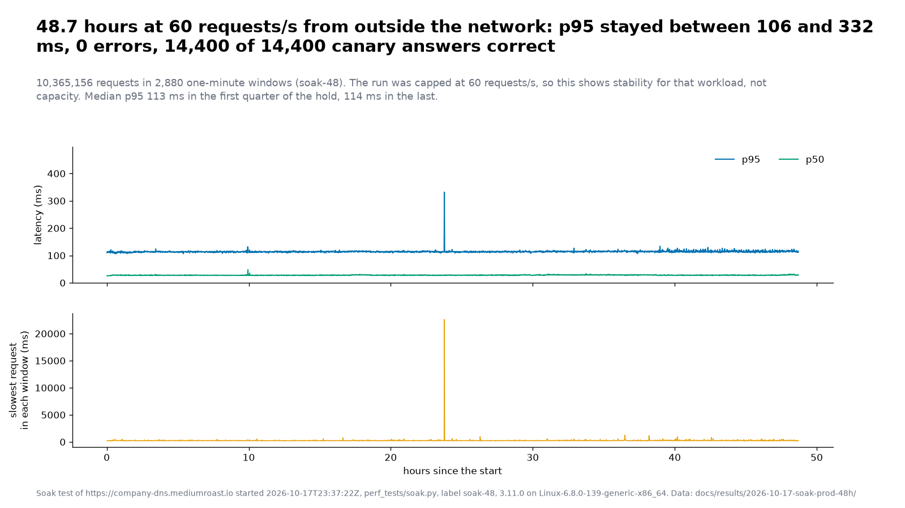
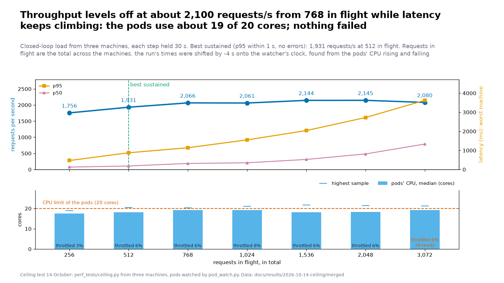
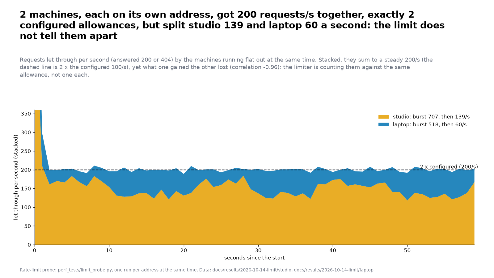
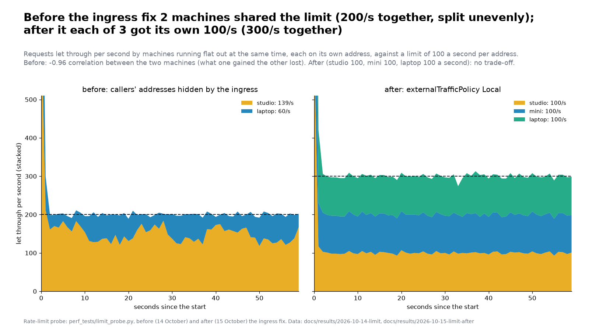
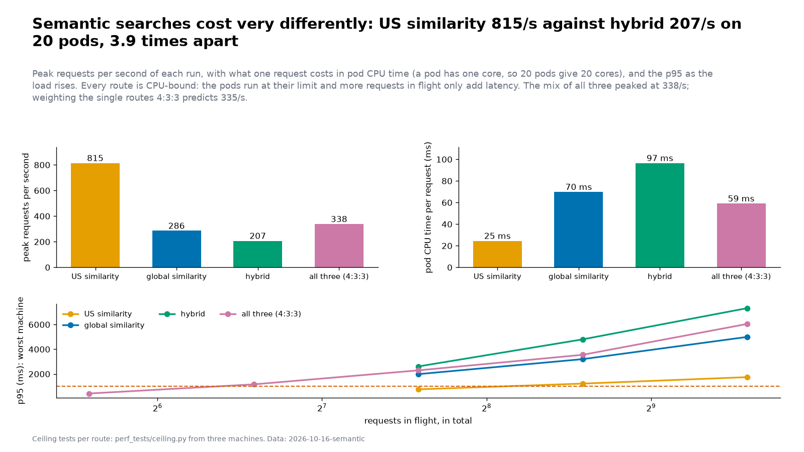
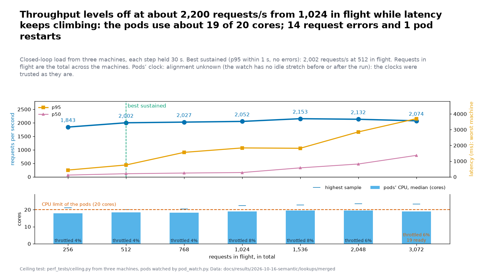

# company_dns V4.0.0-pre: performance report (2026-10-12)

What was measured about V4 before it goes to production: how it compares with V3, how it should be sized on the cluster, and whether it stays stable over a day. Three sets of evidence, each repeatable
with the tools in this repository. Written for the maintainers and for anyone deciding how big a deployment should be.

## The short version

| Question | Answer | Evidence |
|---|---|---|
| Is V4 faster than V3? | Faster on 26 of 28 checks, level on 2, slower on none (at the production limits of 0.5 CPU and 1 GiB) | single-image comparison, 2026-10-10 |
| How should a replica be sized? | **About one core per pod, and as many pods as you want to dedicate.** Two or four half-core pods are throttled; pods of two or four cores waste cores on the embedding searches | cluster sizing, 2026-10-11 |
| How much does it carry? | On the 20-pod staging shape (20 x 1000m): **about 1,900 lookups a second** (2,300 when the requests repeat) at p95 around 400 ms, through the real ingress | cluster sizing |
| Does it survive change? | **Yes: a rollback, a roll forward, one and two lost pods, a restart of all pods, and scaling 20 to 16 and back**, at 60 requests/s: no errors, p95 within 5 ms of baseline, memory flat. A finding (pods took the full 30 s to stop) was fixed with a graceful shutdown: pods now leave in 5 to 10 s | rollout under load, 2026-10-13 and 14 |
| Where does it buckle? | **About 2,100 lookups a second**, CPU-limited (18 to 19 of 20 cores), from 768 in flight; best sustained 1,931/s at p95 0.9 s; nothing failed up to 3,072 in flight | ceiling test, three machines, 2026-10-14 |
| How many semantic searches? | **About 340 a second for a mix of the three routes, 815 for US similarity, 286 for global similarity, 207 for hybrid**, CPU-limited on the 20 pods, no errors; the lookups ceiling is unchanged by the ingress change (2,153/s) | route-by-route ceiling, 2026-10-16 |
| Does the per-address limit work? | **Yes, since the ingress fix.** Before it, the ingress hid the callers' addresses and two machines shared two allowances (200/s, split 139 and 60). After `externalTrafficPolicy: Local`, three machines each got exactly 100/s (300 together), no trade-off | limit probe, 2026-10-14 and 15 |
| Does it stay up and correct? | **Yes, for the known workload:** 24 hours on staging (5.18 million requests) and then **48.7 hours on production (10.37 million requests)** at 60 requests/s from outside the network: **no errors**, every known-answer check correct (7,200 of 7,200 and 14,400 of 14,400), p95 within a few ms of 114 ms with no drift. One request took 22.6 s once, cause unknown; the production run has no cluster-side record | soak tests, 2026-10-12 and 13, and 2026-10-17 to 20 |

What none of it shows is stated at the end ("What this does not show"). Read that before quoting a number.

## 1. V4 against V3 (one image each, same hardware)

A matrix run on one benchmark machine (Linux, 32 CPUs), three runs per cell, each route restarted from nothing for the cold pass, ten companies per route. Full figures and their method are in
[`results/2026-10-10-rerun/`](results/2026-10-10-rerun/index.md); the plan behind it is [`plans/v4-results-report.md`](plans/v4-results-report.md).

- **28 checks (every route, cold and warm, two resource regimes): V4 faster on 26, level on 2, slower on none.**
- **Cold latency** at 0.5 CPU and 1 GiB: faster on 6 of 7 routes, level on 1.
- **Repeat traffic:** V4's caches answer Wikipedia lookups in about 3.6 ms against 740 ms cold; V3 has no result cache and takes about 760 ms each time.
- **At 16 concurrent requests** (production limits): batches finish 4.8x faster on routes with no upstream call, and the routes that call Wikipedia and SEC are far faster because V4 answers repeats from memory (the comparison is of warm V4 against V3 doing the full work; read it as a statement about the caches, not the code).
- **CPU and size:** 4.7x less average CPU at the production limits; the image is 2.1x smaller (528 MB against 1,119 MB) and starts 2.7x faster. Idle memory is about 160 MiB and the peak was 187 MiB in that run.
- **Reliability:** in that matrix V3 had 1 incomplete answer, V4 lean 25 error statuses and V4 small none; the details are on the "Failed, errored or incomplete answers" figure and its notes in the index linked above.

## 2. Sizing on the cluster

Run on the two worker nodes through the real ingress, with `perf_tests/run_cluster.py`: the staging Deployment is patched to each shape in turn, a closed-loop load runs at several concurrency levels, and the
pods' own CPU throttling and memory are read from inside. Staging shares the nodes with other services, there is **one run per cell**, so treat differences under about 20% as noise. The data is
[`results/2026-10-12-cluster/sizing.json`](results/2026-10-12-cluster/sizing.json); the plan and its first-round notes are [`plans/v4-sizing-test.md`](plans/v4-sizing-test.md).

### Round 1: equal total CPU (2 cores): fewer larger pods beat more smaller ones

| 2 cores total | embedding req/s | lookups req/s | CPU throttled |
|---|---|---|---|
| 2 x 500m (the V3 pod size) | about 10 to 12 (p95 2.3 to 4.4 s) | 50 | 52 to 93% |
| 4 x 500m | about 21 to 24 (p95 1.2 to 2.8 s) | 104 | 61 to 90% |
| **2 x 1000m** | **43** (p95 0.8 s) | **226** | **about 1 to 3%** |

Half-core pods are starved by the CPU limit, not by pod count: the threads burst, use the quota, and sit idle until the next scheduling period. A pod of one core is not throttled.

### Round 2: 12 cores in three shapes: more one-core pods beat fewer large ones


| 12 cores | embedding req/s (p95 under 1 s) | per core used | lookups req/s at N=256 | lookups p95 | pods per node |
|---|---|---|---|---|---|
| 3 x 4000m / 4Gi | 76 | 8 | 1,196 | 697 ms | 2 + 1 |
| 6 x 2000m / 2Gi | 140 | 13 | 1,230 | 739 ms | 3 + 3 |
| **12 x 1000m / 1Gi** | **231** | **21** | **1,262** | **560 ms** | 6 + 6 |

- **Embedding searches** are 3.0x faster in twelve small pods than in three large ones, although all shapes used 9 to 11 of the 12 cores. An embedding runs one at a time inside a pod, and the extra cores of a big pod are mostly wasted.
  Large pods were also throttled more (13% at 4000m, 26% at 2000m, about 1% at 1000m). The mechanism is the likely cause; it was not isolated by a separate experiment.
- **Lookups** do not care about the shape: about 1,200 to 1,260 requests/s at 12 cores, or about 100 per core, however the cores are cut.

### Round 3: lookups against the number of one-core pods


| pods (1000m / 1Gi) | lookups req/s | p95 | repeated lookups req/s | cores used |
|---|---|---|---|---|
| 12 | 1,262 | 560 ms | | 10.9 |
| 16 | 1,600 | 479 ms | 1,987 | 13.9 |
| **20** | **1,873** | **421 ms** | **2,301** | 16.8 |

Throughput rose with every pod added, about 76 requests/s per pod, and p95 fell. The pods used 84 to 90% of their CPU limit at 256 concurrent requests, so the ceiling is a little higher than these numbers.
Repeated requests (a small pool, as clients that ask for the same codes and words produce) ran about 23% faster than random ones.

### The decision

Staging runs **20 x 1000m with 1 GiB memory** (`k8s/staging/deployment.yaml`; peak memory in these runs was about 250 MiB per pod). The CPU request is half the limit so that the other workloads on the nodes are not crowded out.

## 3. Stability: a 24-hour soak from outside the network

`perf_tests/soak.py`, run by a remote tester (guide: [`soak-test.md`](soak-test.md)) against the staging service from 12 October 03:10 UTC for 24.4 hours. Staging ran image tag `10112026-85feab8` (commit 85feab8, deployed 11 October 22:47 UTC) as 20 pods of 1000m / 1Gi throughout. It sends only `GET` requests for US SIC code and description
lookups and EDGAR searches, ramps in four steps, holds, and every minute asks five known-answer questions (health, a US SIC code on the V4 and V3 paths, an EU NACE class and a Japan SIC industry group).
The files are in [`results/2026-10-12-soak/`](results/2026-10-12-soak/): the per-window `windows.csv`, `summary.md` and `meta.json`.


| | |
|---|---|
| requests | 5,181,863 in 1,440 one-minute windows |
| errors, `429`s | 0, 0 |
| windows missing the bar (error rate above 1%, p95 above 2 s, or a wrong canary) | 0 of 1,440 |
| known-answer checks correct | 7,200 of 7,200, none needed a second try |
| p95 | median 117 ms, between 110 and 126 ms from the first window to the last |
| p50 | 28 ms |
| drift | the median p95 was 116 ms in the first quarter of the hold and 117 ms in the last |
| slowest single request in a window | 1.2 s at worst, twice in the day; it never moved p95 |
| throughput | 60 requests/s in every window after the first ten (the cap) |

**For this known workload, stability is proven:** no errors, no wrong answers, no drift.

### 3b. The same soak on production, for 48 hours (17 to 20 October)

After the cutover (17 October) a remote tester ran the soak again, this time against **production** (`company-dns.mediumroast.io`, V4, image `10172026-0eaeb0b`, 20 pods) with V3 standing by, from 17 October 23:37 UTC for 48.7 hours (instructions: [`soak-prod-48h.md`](soak-prod-48h.md)). The same workload as section 3: `GET` lookups at a steady 60 requests/s, no credentials, five known-answer questions every minute. The files are in [`results/2026-10-17-soak-prod-48h/`](results/2026-10-17-soak-prod-48h/).



| | |
|---|---|
| requests | 10,365,156 in 2,880 one-minute windows |
| errors, `429`s | 0, 0 |
| windows missing the bar (error rate above 1%, p95 above 2 s, or a wrong canary) | 0 of 2,880 |
| known-answer checks correct | 14,400 of 14,400 |
| p95 | median 113.9 ms; 95% of windows under 117.7 ms |
| p50 | median 27.9 ms |
| drift | the median p95 was 113.2 ms in the first quarter of the hold and 114.3 ms in the last; by six-hour blocks 113.2 to 114.6 ms |
| throughput | 60.0 requests/s (the cap) in 2,836 of the 2,840 windows of the hold; the other four were 47.5 (the oddity below), 59.2, 59.8 and 59.8 |
| the slowest request | 22.6 seconds, once, at 23:22 UTC on 18 October (about 23.8 hours in); see below |

**For this known workload, stability on production is proven for two days**: no errors, no wrong answers, no drift, and the latency a client sees is the same as on staging in section 3 (median p95 117 ms, p50 28 ms).

- **The one oddity.** In a single one-minute window (23:22 UTC on 18 October) one request took 22.6 seconds, p95 rose to 332 ms and the rate fell to 47.5 requests/s. It still answered (no error was counted) and the window did not miss the bar, and the next window was normal. **We do not know the cause**: it could be the tester's network, the ingress or a pod, and there is no cluster-side record to tell them apart (below).
- **What was not observed: the cluster side.** The pod watcher was meant to run beside the soak and did not (it was started outside `tmux` and ended after 2 hours 17 minutes), and its label selector was V3's, so even those two hours recorded V3's four pods (idle, no restarts) and not one V4 pod. **Memory, CPU, restarts and out-of-memory kills of V4's pods during these 48 hours were not recorded.** The watcher now takes `--selector` (pull request 177). Not run again by decision.
- **Not shown:** capacity (the rate was capped at 60 requests/s), any route but the lookups, and the event's real traffic. A different workload needs its own evidence.

## 4. Changes under load: rollback, roll forward and a lost pod (13 October)

The first run of soak scenario 2 ([`soak-scenarios.md`](soak-scenarios.md)): the soak at a steady 60 requests/s for two hours from a machine on the cluster's own network (so its latencies are lower than the remote run's),
with `pod_watch.py` on the build node reading the pods every 15 seconds, while the deployment was changed between two images: `10132026-7a8c8ac` (the new one, built from `main` at the merge of #146, which includes the `429` message fix and the single version source) and `10112026-85feab8` (the one the 24-hour soak ran on). The soak's windows were lined up with the watcher's clock from the load itself (a 2-second difference, found from the pods'
CPU rising and falling; nobody compared clocks). The files are in [`results/2026-10-13-rollout/`](results/2026-10-13-rollout/).

| | |
|---|---|
| the whole run | 120 windows, 431,153 requests, **0 errors, 0 `429`s, 600 of 600 canary answers correct**; p95 median 96 ms (worst window 100 ms); first quarter of the hold 95.2 ms, last quarter 96.4 ms |
| changes made | **rollback** to the previous image (16:41 UTC), **roll forward** to the new one (17:18), **delete one pod** (17:39); each PASS: no errors, every canary right, worst p95 99.6, 99.1 and 96.9 ms against a 96 ms baseline, and 60.0 requests/s held in every window |
| the slowest request | 335 ms in the windows around the changes; 1,045 ms once, in a quiet window |
| pods, from the cluster | **0 restarts, no out-of-memory kills**, 20 ready pods at every sample (the 15-second sampling would miss a gap shorter than that), CPU throttling at most 0.2% |
| CPU | 0.05 cores used while idle and 0.84 across the 20 pods at 60 requests/s (about 70 requests/s per core used at this load) |
| memory | **flat**: the first pods held 190.9 MiB (largest pod) from the start to the rollback, then fresh pods held 163 MiB for the rest of the run (163.1, then 163.3, then 163.1 MiB across 35 minutes); the 28 MiB gap is the same image on pods that had served the deploy's API test suite before the soak, not an image difference |

**Not run:** three of the six planned changes (delete two pods at once, restart all pods, scale 20 to 16 and back). The first changes began 48 minutes in instead of 15, and the run ended first.

**What the rollouts looked like.** A full 20-pod rollout took about a minute from the first new pod to the last, never fewer than 20 pods ready, and never more than 24 live pods (20 plus the surge of 4). The old pods were slower to go:
**every one of the 41 pods that were stopped stayed in `Terminating` for 30 to 45 seconds**, the whole 30-second grace period. The server has no handler for the stop signal (it runs as the container's first process, which ignores it by default), so Kubernetes waits out the grace period and then kills it.
Nothing was lost at this load, because traffic had already moved to the new pods, but: a rollout briefly holds up to 40 pods (20 of them stopping), requests still in flight when the kill arrives would be cut, and a pod lost under heavy traffic takes 30 seconds to leave. A graceful shutdown (stop accepting, finish what is running, exit) would make pods leave in a second or two.
**The graceful shutdown has since been made and tested** (section 4b).

### 4b. The remaining changes, on the graceful-shutdown build (14 October)

The server now keeps serving for 5 seconds after the stop signal, then drains and exits (`v4/crates/server/src/shutdown.rs`). The same scenario, on image `10142026-4446caf` (commit 4446caf), run for 66 minutes with the pods sampled every 5 seconds: one pod deleted, two pods deleted at once (one per node), all pods restarted, the deployment scaled from 20 to 16 and back. The files are in [`results/2026-10-14-shutdown/`](results/2026-10-14-shutdown/).

| | |
|---|---|
| the whole run | 66 windows, 236,830 requests, **0 errors, 0 `429`s, 330 of 330 canary answers correct**; p95 median 93 ms (worst window 98 ms), no drift (93.9 ms in the first quarter of the hold, 92.9 ms in the last) |
| the six marks | all PASS; worst p95 around a change 92 to 98 ms against a 93 ms baseline; 60.0 requests/s held |
| **stopped pods** | **27 pods were stopped; each stayed in `Terminating` 5 to 10 seconds (median 5)**, against 30 to 45 seconds before (41 of 41 pods). No more than 8 were stopping at once in a full restart (20 before) |
| two pods lost at once | ready pods dipped to 18 for one 5-second sample and to 19 for the next, and were back at 20 about 10 seconds after the deletion; no errors |
| restart of all pods | about 25 seconds from the first new pod to the last; never fewer than 20 ready; at most 32 pods existing at the peak (20 plus the surge of 4 plus 8 still stopping) |
| scale 20 to 16 and back | the 4 extra pods left within about 5 to 10 seconds; scaling up, 4 new pods were ready about 10 seconds after the command |
| cluster side | **0 restarts, no out-of-memory kills**, CPU throttling at most 0.4%, 0.89 cores used across the pods at 60 requests/s, memory flat (191 MiB on the oldest pods, 164 to 165 MiB on fresh ones throughout) |

**All six changes planned for the rollout scenario have now been run** (rollback, roll forward, one pod, two pods, restart all, scaling), on the new build, with no request errors and no change in latency that the client could see.

## 5. The ceiling and the per-address limit (14 October)

### 5a. Where the pods buckle: about 2,100 lookups a second, limited by CPU

Three machines (a Mac Studio, a Mac mini and a laptop) ran the lookups ramp together against the 20-pod staging service as a profile with no rate limit (`perf_tests/ceiling.py`): 256, 512, 768, 1,024, 1,536, 2,048 and 3,072 requests in flight in total, 30 seconds each, with the pods watched from the cluster side and production watched alongside. Image `10142026-4446caf`.
Files: [`results/2026-10-14-ceiling/`](results/2026-10-14-ceiling/).



| in flight | requests/s | p50 ms | p95 ms | errors | pods' CPU, median (cores of 20) | throttled |
|---|---|---|---|---|---|---|
| 256 | 1,756 | 126 | 471 | 0 | 17.5 | 3.3% |
| **512** | **1,931** | 184 | **876** | 0 | 18.1 | 5.6% |
| 768 | 2,066 | 317 | 1,140 | 0 | 19.3 | 6.0% |
| 1,024 | 2,061 | 351 | 1,551 | 0 | 19.2 | 7.7% |
| 1,536 | 2,144 | 527 | 2,039 | 0 | 18.1 | 6.1% |
| 2,048 | **2,145** | 815 | 2,722 | 0 | 18.3 | 5.9% |
| 3,072 | 2,080 | 1,333 | 3,623 | 0 | 19.3 | 6.3% |

- **Best sustained** (p95 within 1 s, no errors): **1,931 requests/s at 512 in flight.** **Peak** 2,145 requests/s at 2,048.
- **The ceiling is CPU.** Throughput stops growing from about 768 in flight, at roughly 2,100 requests/s, while every extra request in flight only adds waiting: p95 goes from 0.9 s to 3.6 s. The pods used 18 to 19 of their 20 cores (highest samples a little over 21) with 3 to 8% of CPU periods throttled. This matches the sizing rounds (about 100 lookups a second per core).
- **Nothing failed up to 3,072 in flight:** no request errors, no `429`s, 0 restarts, no out-of-memory kills (memory 166 to 172 MiB per pod).
- **The first sign of strain is at the top step:** ready pods fell briefly to 18 (two pods failing their health check for a few seconds under saturation) and recovered by themselves, with no restart.
- **The load generators were not the limit** (under 2.3 cores in total across the three machines' processes at the top step).
- **Production was not affected:** its four pods stayed ready with 0 restarts, at 0.02 cores for the whole run.

Embedding searches at 20 pods were not run in this session.

### 5b. Before the fix: the per-address limit did not tell the machines apart (14 October; fixed 15 October, see 5c)

The probe `perf_tests/limit_probe.py` sent requests flat out for 60 seconds from each of two machines at the same time, each on its own address, as an identified caller, against a quota configured at 6,000 a minute (100 a second) with a burst of 600 for each address. Files: [`results/2026-10-14-limit/`](results/2026-10-14-limit/).



| | burst (let through before the first `429`) | sustained, per second |
|---|---|---|
| Studio | 707 | 139 |
| laptop | 518 | 60 |
| **together** | 1,225 | **200** (mean 199.9 over seconds 10 to 59, between 189 and 210) |

- **Together** they got exactly two allowances of 100 a second and, in the first second, about two bursts of 600. **Separately** they did not: one got 139 a second, more than its configured 100, and the other 60.
- **What one gained, the other lost** (correlation of the two per-second counts −0.96). Two machines on separate allowances would each have had about 100.
- **What this says:** the limiter is not counting the two machines as two separate addresses. It is counting them against shared allowances, a small number of them (two, judging by the total). The likely reason is that the ingress does not pass the callers' real addresses to the pods, so the pods see the address of the ingress or node instead. This is **not yet confirmed**: it needs the ingress service's `externalTrafficPolicy` and the ingress pods' layout.
- **What it would mean:** the per-address limit would be a limit shared by all callers, about 200 requests a second in all for identified and anonymous lookups (two allowances), not 100 each. One heavy caller could use it all and leave the rest limited. For an event with hundreds of teams that is far below the 2,100 requests a second the pods can carry. Callers with a profile that has no limit are unaffected.
- **A separate behaviour, checked only on a local server** (the Mac mini's check of it failed on DNS): a lookup that carries `Origin: https://mediumroast.io`, or a `Referer` from it, is not limited at all (60 of 60 let through from one address). The header is set by the client, so anyone can send it.
- **The Mac mini's probe** failed outright (96 of 96 requests errored, its DNS was wrong at the time), so two addresses were measured, not three.

### 5c. After the ingress fix (15 October): each address gets its own allowance

The ingress service was changed to `externalTrafficPolicy: Local` (made durable in its Helm values) and the CoreDNS entry for the public names was repointed to Traefik's ClusterIP; see `docs/plans/onprem-k8s-migration.md`, "The ingress keeps the callers' addresses". The same probe was then run from **three machines on three addresses at the same time**, 60 seconds flat out, the same quota (6,000 a minute, burst 600 per address). Files: [`results/2026-10-15-limit-after/`](results/2026-10-15-limit-after/).



| | let through in 60 s | burst above the sustained rate | sustained, per second | per-second range (seconds 10 to 59) |
|---|---|---|---|---|
| Studio | 6,573 | about 573 | **100.0** | 93 to 107 |
| Mac mini | 6,579 | about 579 | **100.0** | 94 to 105 |
| laptop | 6,560 | about 560 | **100.0** | 75 to 109 |
| **together** | 19,712 | | **300** (mean 300, between 274 and 313) | |

- **Each address got exactly its configured allowance**: 100 a second after a burst of about 600 (the most one address can get in 60 seconds at 6,000 a minute with a burst of 600 is 6,600; each got 6,560 to 6,579). Three addresses together got three allowances, 300 a second; before the fix two addresses got 200 between them.
- **No trade-off between the machines** (correlation of the per-second counts between pairs: 0.55 Studio and Mini, 0.08 Studio and laptop, -0.06 Mini and laptop; before the fix it was -0.96).
- **The load was spread evenly across the 20 pods** while the three machines flooded the service with about 11,000 requests a second in all, mostly `429`s: each pod used between 14 and 19 CPU-seconds over the busy minute (largest over smallest 1.4). No pod restarted, all 20 stayed ready, peak memory 171 MiB.
- **The count of requests let through before the first `429`** (404 to 445) is a lower bound on the burst, not the burst: the first `429` comes from the first pod to use up its own share. The probe now also reports the burst from the totals.

The aggregate for many addresses is therefore each address's allowance times the number of addresses, up to what the pods carry (about 2,100 lookups a second): about 20 addresses at the full rate would reach it. The ceiling itself was re-tested the next day and is unchanged (section 5d).

### 5d. Semantic searches at 20 pods, route by route, and the lookups ceiling again (16 October)

Two questions were still open after 5c: how many semantic searches a second the 20 pods carry (measured before only at 12 pods and for a two-route mix: 231 a second), and whether the lookups ceiling of 5a still holds now that one Traefik pod carries all the external traffic. Five runs from three machines at the same time, as the `staging-test` profile, with the pods watched from the cluster side. Files: [`results/2026-10-16-semantic/`](results/2026-10-16-semantic/); protocol: scenario 6 in `docs/soak-scenarios.md`.



| Route | Peak | Per pod | Pod CPU per request | p95 at the lowest level tried | Best sustained (p95 within 1 s) |
|---|---|---|---|---|---|
| US similarity | **815/s** | 41/s | 25 ms | 759 ms at 192 in flight | 801/s at 192 |
| global similarity | **286/s** | 14/s | 70 ms | 1,987 ms at 192 | none: 192 in flight was already past it |
| hybrid (keyword and semantic, all systems) | **207/s** | 10/s | 97 ms | 2,610 ms at 192 | none: 192 in flight was already past it |
| all three together (4:3:3) | **338/s** | 17/s | 59 ms | 421 ms at 48 | 310/s at 48 |
| SIC lookups | **2,153/s** | 108/s | 9 ms | 432 ms at 256 | 2,002/s at 512 |

- **Every route is limited by CPU, and more requests in flight only add latency.** Throughput is flat from the lowest level to the highest (for example hybrid 206, 206, 207 a second at 192, 384 and 768 in flight) while the pods use 18 to 20 of their 20 cores and p95 climbs from 2.6 s to 7.3 s. Requests did not fail (no errors until the last lookups step, no `429`s); the one exception is the pod restarts described below.
- **The routes differ by a factor of four.** A US similarity search costs about 25 ms of pod CPU, a global one 70 ms, a hybrid one 97 ms. The mix's peak agrees with the single routes: weighting them 4:3:3 predicts 335 a second, and the measured peak was 338.
- **The best sustained rate for global similarity and hybrid was not found.** The lowest level tried (192 in flight) was already past p95 of 1 s. The mixed run suggests where they stand (it passed at 48 in flight and failed at 96), so about 280 and 200 a second are their capacities, but a run at lower levels (for example 24, 48 and 96) is needed for a "sustained" figure. This is the only gap left from this run.
- **Memory is not a constraint:** the largest pod reached 299 MiB (limit 1 GiB), and it did not grow with the load.
- **The lookups ceiling is unchanged by the ingress change:** peak 2,153 a second at 1,536 in flight, against 2,145 before (5a); best sustained 2,002 at 512. One Traefik pod is not the limit. CPU is, at 19 of 20 cores.



**A finding at extreme overload: two health-check restarts.** Both came well past the rates that matter (hybrid at 768 in flight, far past its capacity, and lookups at 3,072 in flight):

- During hybrid at 768 in flight (about 13:18 UTC): one pod was restarted and two more were out of "ready" for about 10 seconds each.
- During lookups at 3,072 in flight (about 13:27 UTC): one pod was restarted; 14 requests failed (0.02%).

Our reading, from the manifest and the timing and not confirmed in the pod logs: a pod running flat out at its CPU limit can miss the `/health` check, which times out after 3 seconds (`timeoutSeconds: 3`), and three misses in a row (`failureThreshold: 3`, every 10 s) make Kubernetes restart it. Restarting an already overloaded pod removes its capacity and sends its share to the others, which can make an overload worse. A liveness probe that is more patient (for example `timeoutSeconds: 5`, `failureThreshold: 6`) would avoid this; the readiness probe can stay strict, because taking an overloaded pod out of rotation sheds load. Changed afterwards in the staging Deployment, from which the production one is copied: liveness now allows 5 s and 6 failures, a full minute before a restart (`k8s/staging/deployment.yaml`, pull request 160); the readiness probe is unchanged. The clocks of the machines and of the pods were trusted as they are (the watcher had no idle stretch to line them up from); the restarts fall inside the steps named above by their start times.

What this means for the event: a mix of searches peaks at about 340 a second, and a single route between 200 and 800. Even if every one of 300 teams ran one semantic search a second at the same time, that would be at the edge of what hybrid or global similarity alone can carry, and well within lookups. A realistic load is far lower, and the service degrades by slowing down (queueing), not by failing, up to several times its capacity.

## 6. What this means for sizing a deployment

| Shape | Lookups | Embedding searches | Notes |
|---|---|---|---|
| 20 x 1000m (the staging shape) | about 1,900 requests/s measured (2,300 repeated), p95 about 400 ms | **338 requests/s for the mix of three routes (815 US similarity, 286 global, 207 hybrid), measured** at 20 pods | the shape chosen for the October load |
| 12 x 1000m | about 1,260 measured | 231 measured | half the cores |

The per-address limit is a setting, not capacity: since the ingress fix (section 5c) each address gets its own 6,000 a minute (100 a second), and many addresses add up to what the pods carry. Before the fix all callers shared about 200 a second (section 5b).

## 7. What this does not show

- **Capacity from a remote client.** The soak was capped at 60 requests/s (the soak's cap, chosen to stay under the per-address quota), about 3% of what the 20 pods carried in the sizing runs. Every step of its ramp ran at the same rate. The sizing figures come from a load generator inside the network.
- **The trusted-`Origin` behaviour** was checked on a local server only.
- **The credentialed (profile) path, the SQL endpoint, and 300 simultaneous callers:** not measured. The best sustained rate of global similarity and hybrid (section 5d) was not found, only their peaks; the health-check restarts at extreme overload were read from the pods' samples, not from their logs.
- **Server memory and restarts during the soak.** A client cannot see them. They must be read from the cluster (restart counts, memory per pod).
- **Server memory during the 24-hour soak was not sampled.** The cluster showed the 20 pods with **0 restarts** after 38 hours (checked 13 October). The two-hour rollout run (section 4) did sample memory, and it was flat.
- **The rollout runs** were at 60 requests/s from the cluster's own network, not at heavy load: whether a pod lost under hundreds of requests a second drops any in flight is untested (the graceful shutdown is meant to prevent it).
- **One run per cell** in the sizing, on nodes shared with other services; the load is closed-loop (a fixed number of requests in flight), which measures capacity, not a traffic model. A real event is bursty.
- **The tester's network.** A p50 of 28 ms suggests it was close to the cluster; a distant client sees more latency.
- **The single-image comparison** is one machine, three runs per cell, and its repeat-traffic ratios measure the caches.

## 8. Reproducing it

```bash
# 1. single image against single image: see docs/plans/v4-results-report.md (perf_tests/run_matrix.py, then perf_tests/report.py)
# 2. cluster sizing, on a machine that reaches the cluster (never during an event):
python3 perf_tests/run_cluster.py --configs 12x1000m/1Gi,16x1000m/1Gi,20x1000m/1Gi --mixes lookups,repeated --concurrency 64 128 256 --processes 8 --dry-run
# 3. the soak, from anywhere: docs/soak-test.md
python3 perf_tests/soak.py --label your-name-where --hours 24 --rps 60
# 4. these pictures, from the committed files:
perf_tests/.venv/bin/python perf_tests/report_cluster.py --sizing docs/results/2026-10-12-cluster/sizing.json --soak docs/results/2026-10-12-soak --out docs/results/2026-10-12
```

The numbers in this document are computed from the committed data by `perf_tests/report_cluster.py` and checked by `perf_tests/test_report_cluster.py`.
