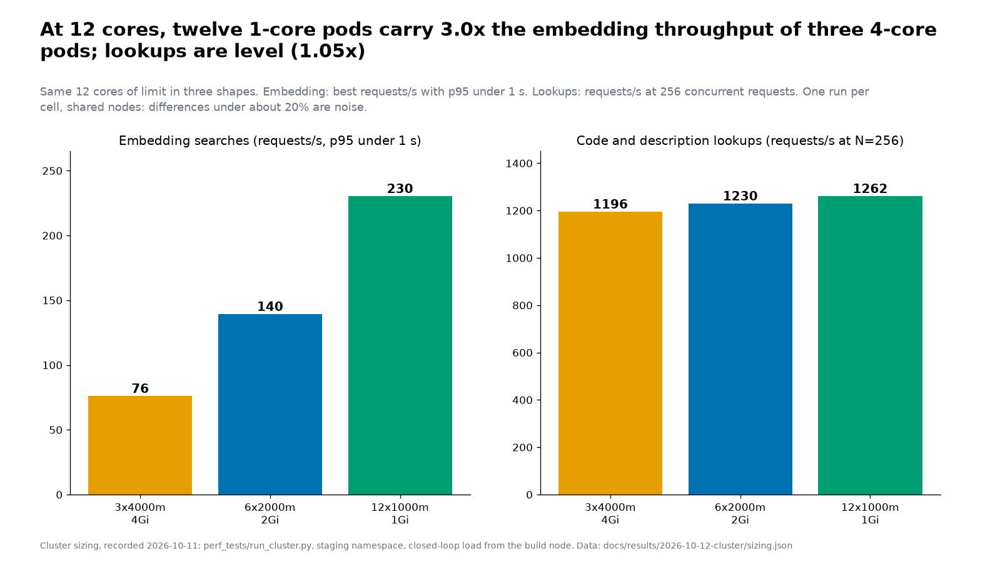
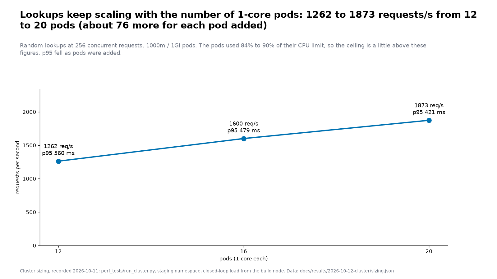
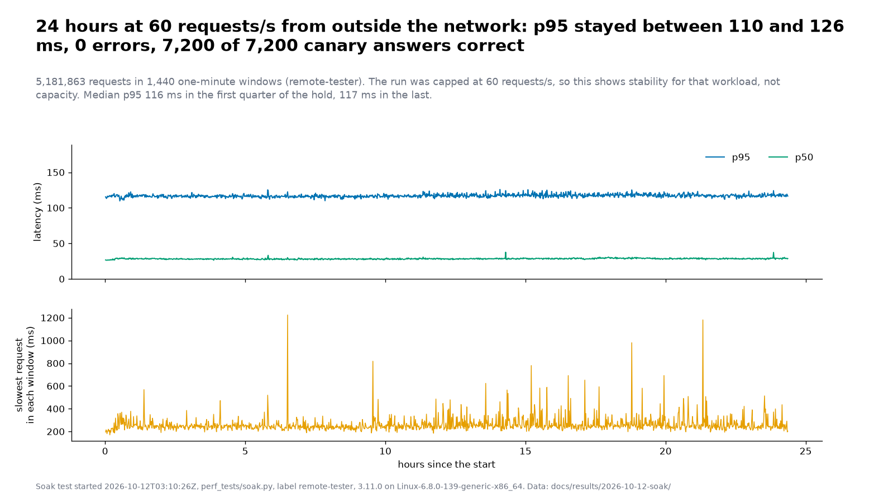

# company_dns V4.0.0-pre: performance report (2026-10-12)

What was measured about V4 before it goes to production: how it compares with V3, how it should be sized on the cluster, and whether it stays stable over a day. Three sets of evidence, each repeatable
with the tools in this repository. Written for the maintainers and for anyone deciding how big a deployment should be.

## The short version

| Question | Answer | Evidence |
|---|---|---|
| Is V4 faster than V3? | Faster on 26 of 28 checks, level on 2, slower on none (at the production limits of 0.5 CPU and 1 GiB) | single-image comparison, 2026-10-10 |
| How should a replica be sized? | **About one core per pod, and as many pods as you want to dedicate.** Two or four half-core pods are throttled; pods of two or four cores waste cores on the embedding searches | cluster sizing, 2026-10-11 |
| How much does it carry? | On the 20-pod staging shape (20 x 1000m): **about 1,900 lookups a second** (2,300 when the requests repeat) at p95 around 400 ms, through the real ingress | cluster sizing |
| Does it survive change? | **Yes, for a rollback, a roll forward and a lost pod** at 60 requests/s: no errors, p95 within 4 ms of baseline, memory flat. One finding: pods take the full 30 s to stop (no graceful shutdown) | rollout under load, 2026-10-13 |
| Does it stay up and correct? | **Yes, for the known workload:** 24 hours at 60 requests/s from outside the network, 5.18 million requests, **no errors**, 7,200 of 7,200 known-answer checks correct, p95 110 to 126 ms with no drift | soak test, 2026-10-12 and 13 |

What none of it shows is stated at the end ("What this does not show"). Read that before quoting a number.

## 1. V4 against V3 (one image each, same hardware)

A matrix run on one benchmark machine (Linux, 32 CPUs), three runs per cell, each route restarted from nothing for the cold pass, ten companies per route. Full figures and their method are in
[`results/2026-10-10-rerun/`](results/2026-10-10-rerun/index.md); the plan behind it is [`plans/v4-results-report.md`](plans/v4-results-report.md).

- **28 checks (every route, cold and warm, two resource regimes): V4 faster on 26, level on 2, slower on none.**
- **Cold latency** at 0.5 CPU and 1 GiB: faster on 6 of 7 routes, level on 1.
- **Repeat traffic:** V4's caches answer Wikipedia lookups in about 3.6 ms against 740 ms cold; V3 has no result cache and takes about 760 ms each time.
- **At 16 concurrent requests** (production limits): batches finish 4.8x faster on routes with no upstream call, and the routes that call Wikipedia and SEC are far faster because V4 answers repeats from memory (the comparison is of warm V4 against V3 doing the full work; read it as a statement about the caches, not the code).
- **CPU and size:** 4.7x less average CPU at the production limits; the image is 2.1x smaller (528 MB against 1,119 MB) and starts 2.7x faster. Idle memory is about 160 MiB and the peak was 187 MiB in that run.
- **Reliability:** in that matrix V3 had 1 incomplete answer, V4 lean 25 error statuses and V4 small none; the details are on the "Failed, errored or incomplete answers" figure and its notes in the index linked above.

## 2. Sizing on the cluster

Run on the two worker nodes through the real ingress, with `perf_tests/run_cluster.py`: the staging Deployment is patched to each shape in turn, a closed-loop load runs at several concurrency levels, and the
pods' own CPU throttling and memory are read from inside. Staging shares the nodes with other services, there is **one run per cell**, so treat differences under about 20% as noise. The data is
[`results/2026-10-12-cluster/sizing.json`](results/2026-10-12-cluster/sizing.json); the plan and its first-round notes are [`plans/v4-sizing-test.md`](plans/v4-sizing-test.md).

### Round 1: equal total CPU (2 cores): fewer larger pods beat more smaller ones

| 2 cores total | embedding req/s | lookups req/s | CPU throttled |
|---|---|---|---|
| 2 x 500m (the V3 pod size) | about 10 to 12 (p95 2.3 to 4.4 s) | 50 | 52 to 93% |
| 4 x 500m | about 21 to 24 (p95 1.2 to 2.8 s) | 104 | 61 to 90% |
| **2 x 1000m** | **43** (p95 0.8 s) | **226** | **about 1 to 3%** |

Half-core pods are starved by the CPU limit, not by pod count: the threads burst, use the quota, and sit idle until the next scheduling period. A pod of one core is not throttled.

### Round 2: 12 cores in three shapes: more one-core pods beat fewer large ones



| 12 cores | embedding req/s (p95 under 1 s) | per core used | lookups req/s at N=256 | lookups p95 | pods per node |
|---|---|---|---|---|---|
| 3 x 4000m / 4Gi | 76 | 8 | 1,196 | 697 ms | 2 + 1 |
| 6 x 2000m / 2Gi | 140 | 13 | 1,230 | 739 ms | 3 + 3 |
| **12 x 1000m / 1Gi** | **231** | **21** | **1,262** | **560 ms** | 6 + 6 |

- **Embedding searches** are 3.0x faster in twelve small pods than in three large ones, although all shapes used 9 to 11 of the 12 cores. An embedding runs one at a time inside a pod, and the extra cores of a big pod are mostly wasted.
  Large pods were also throttled more (13% at 4000m, 26% at 2000m, about 1% at 1000m). The mechanism is the likely cause; it was not isolated by a separate experiment.
- **Lookups** do not care about the shape: about 1,200 to 1,260 requests/s at 12 cores, or about 100 per core, however the cores are cut.

### Round 3: lookups against the number of one-core pods



| pods (1000m / 1Gi) | lookups req/s | p95 | repeated lookups req/s | cores used |
|---|---|---|---|---|
| 12 | 1,262 | 560 ms | | 10.9 |
| 16 | 1,600 | 479 ms | 1,987 | 13.9 |
| **20** | **1,873** | **421 ms** | **2,301** | 16.8 |

Throughput rose with every pod added, about 76 requests/s per pod, and p95 fell. The pods used 84 to 90% of their CPU limit at 256 concurrent requests, so the ceiling is a little higher than these numbers.
Repeated requests (a small pool, as clients that ask for the same codes and words produce) ran about 23% faster than random ones.

### The decision

Staging runs **20 x 1000m with 1 GiB memory** (`k8s/staging/deployment.yaml`; peak memory in these runs was about 250 MiB per pod). The CPU request is half the limit so that the other workloads on the nodes are not crowded out.

## 3. Stability: a 24-hour soak from outside the network

`perf_tests/soak.py`, run by a remote tester (guide: [`soak-test.md`](soak-test.md)) against the staging service from 12 October 03:10 UTC for 24.4 hours. Staging ran image tag `10112026-85feab8` (commit 85feab8, deployed 11 October 22:47 UTC) as 20 pods of 1000m / 1Gi throughout. It sends only `GET` requests for US SIC code and description
lookups and EDGAR searches, ramps in four steps, holds, and every minute asks five known-answer questions (health, a US SIC code on the V4 and V3 paths, an EU NACE class and a Japan SIC industry group).
The files are in [`results/2026-10-12-soak/`](results/2026-10-12-soak/): the per-window `windows.csv`, `summary.md` and `meta.json`.



| | |
|---|---|
| requests | 5,181,863 in 1,440 one-minute windows |
| errors, `429`s | 0, 0 |
| windows missing the bar (error rate above 1%, p95 above 2 s, or a wrong canary) | 0 of 1,440 |
| known-answer checks correct | 7,200 of 7,200, none needed a second try |
| p95 | median 117 ms, between 110 and 126 ms from the first window to the last |
| p50 | 28 ms |
| drift | the median p95 was 116 ms in the first quarter of the hold and 117 ms in the last |
| slowest single request in a window | 1.2 s at worst, twice in the day; it never moved p95 |
| throughput | 60 requests/s in every window after the first ten (the cap) |

**For this known workload, stability is proven:** no errors, no wrong answers, no drift.

## 4. Changes under load: rollback, roll forward and a lost pod (13 October)

The first run of soak scenario 2 ([`soak-scenarios.md`](soak-scenarios.md)): the soak at a steady 60 requests/s for two hours from a machine on the cluster's own network (so its latencies are lower than the remote run's),
with `pod_watch.py` on the build node reading the pods every 15 seconds, while the deployment was changed between two images: `10132026-7a8c8ac` (the new one, built from `main` at the merge of #146, which includes the `429` message fix and the single version source) and `10112026-85feab8` (the one the 24-hour soak ran on). The soak's windows were lined up with the watcher's clock from the load itself (a 2-second difference, found from the pods'
CPU rising and falling; nobody compared clocks). The files are in [`results/2026-10-13-rollout/`](results/2026-10-13-rollout/).

| | |
|---|---|
| the whole run | 120 windows, 431,153 requests, **0 errors, 0 `429`s, 600 of 600 canary answers correct**; p95 median 96 ms (worst window 100 ms); first quarter of the hold 95.2 ms, last quarter 96.4 ms |
| changes made | **rollback** to the previous image (16:41 UTC), **roll forward** to the new one (17:18), **delete one pod** (17:39); each PASS: no errors, every canary right, worst p95 99.6, 99.1 and 96.9 ms against a 96 ms baseline, and 60.0 requests/s held in every window |
| the slowest request | 335 ms in the windows around the changes; 1,045 ms once, in a quiet window |
| pods, from the cluster | **0 restarts, no out-of-memory kills**, 20 ready pods at every sample (the 15-second sampling would miss a gap shorter than that), CPU throttling at most 0.2% |
| CPU | 0.05 cores used while idle and 0.84 across the 20 pods at 60 requests/s (about 70 requests/s per core used at this load) |
| memory | **flat**: the first pods held 190.9 MiB (largest pod) from the start to the rollback, then fresh pods held 163 MiB for the rest of the run (163.1, then 163.3, then 163.1 MiB across 35 minutes); the 28 MiB gap is the same image on pods that had served the deploy's API test suite before the soak, not an image difference |

**Not run:** three of the six planned changes (delete two pods at once, restart all pods, scale 20 to 16 and back). The first changes began 48 minutes in instead of 15, and the run ended first.

**What the rollouts looked like.** A full 20-pod rollout took about a minute from the first new pod to the last, never fewer than 20 pods ready, and never more than 24 live pods (20 plus the surge of 4). The old pods were slower to go:
**every one of the 41 pods that were stopped stayed in `Terminating` for 30 to 45 seconds**, the whole 30-second grace period. The server has no handler for the stop signal (it runs as the container's first process, which ignores it by default), so Kubernetes waits out the grace period and then kills it.
Nothing was lost at this load, because traffic had already moved to the new pods, but: a rollout briefly holds up to 40 pods (20 of them stopping), requests still in flight when the kill arrives would be cut, and a pod lost under heavy traffic takes 30 seconds to leave. A graceful shutdown (stop accepting, finish what is running, exit) would make pods leave in a second or two.
It is a small change; it has not been made.

## 5. What this means for sizing a deployment

| Shape | Lookups | Embedding searches | Notes |
|---|---|---|---|
| 20 x 1000m (the staging shape) | about 1,900 requests/s measured (2,300 repeated), p95 about 400 ms | **about 380 requests/s by extrapolation from 12 pods (19 per pod); not measured** | the shape chosen for the October load |
| 12 x 1000m | about 1,260 measured | 231 measured | half the cores |

Per-IP limits are settings, not capacity: with 20 pods and a quota of 6,000 a minute (burst 600) a single address is held to 100 requests/s, far below what the pods carry.

## 6. What this does not show

- **Capacity from a remote client.** The soak was capped at 60 requests/s (the soak's cap, chosen to stay under the per-address quota), about 3% of what the 20 pods carried in the sizing runs. Every step of its ramp ran at the same rate. The sizing figures come from a load generator inside the network.
- **The per-IP limiter at 20 pods.** The soak never reached the quota, so no `429` was seen. The step-6.3 check in the bring-up guide has not been run at this size.
- **Embedding searches at 20 pods**, the credentialed (profile) path, the SQL endpoint, and 300 simultaneous callers: not measured. The measured embedding figures are at 12 pods and below.
- **Server memory and restarts during the soak.** A client cannot see them. They must be read from the cluster (restart counts, memory per pod).
- **Server memory during the 24-hour soak was not sampled.** The cluster showed the 20 pods with **0 restarts** after 38 hours (checked 13 October). The two-hour rollout run (section 4) did sample memory, and it was flat.
- **Three of the six changes of the rollout run** (two pods at once, restart all, scaling) were not run, and the run was at 60 requests/s from the cluster's own network.
- **One run per cell** in the sizing, on nodes shared with other services; the load is closed-loop (a fixed number of requests in flight), which measures capacity, not a traffic model. A real event is bursty.
- **The tester's network.** A p50 of 28 ms suggests it was close to the cluster; a distant client sees more latency.
- **The single-image comparison** is one machine, three runs per cell, and its repeat-traffic ratios measure the caches.

## 7. Reproducing it

```bash
# 1. single image against single image: see docs/plans/v4-results-report.md (perf_tests/run_matrix.py, then perf_tests/report.py)
# 2. cluster sizing, on a machine that reaches the cluster (never during an event):
python3 perf_tests/run_cluster.py --configs 12x1000m/1Gi,16x1000m/1Gi,20x1000m/1Gi --mixes lookups,repeated --concurrency 64 128 256 --processes 8 --dry-run
# 3. the soak, from anywhere: docs/soak-test.md
python3 perf_tests/soak.py --label your-name-where --hours 24 --rps 60
# 4. these pictures, from the committed files:
perf_tests/.venv/bin/python perf_tests/report_cluster.py --sizing docs/results/2026-10-12-cluster/sizing.json --soak docs/results/2026-10-12-soak --out docs/results/2026-10-12
```

The numbers in this document are computed from the committed data by `perf_tests/report_cluster.py` and checked by `perf_tests/test_report_cluster.py`.
