# V3 versus V4: results figures

Generated by `perf_tests/report.py`. Provenance: host benchmark node (Linux x86_64, 32 CPUs)  |  commit e785e1c+dirty  |  v3: company_dns:09272026-1  |  lean: company-dns-v4:amd64-lean  |  small: company-dns-v4:amd64-small  |  run 2026-10-10T21:40

## V4 against V3 on 28 checks: faster on 26, level on 2, slower on 0

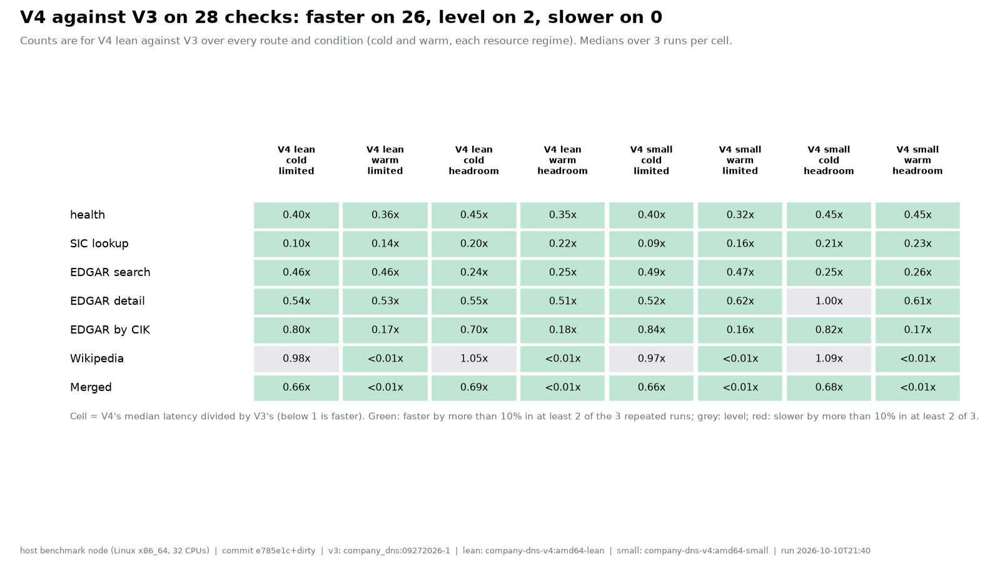

Counts are for V4 lean against V3 over every route and condition (cold and warm, each resource regime). Medians over 3 runs per cell.

## Cold latency: V4 is faster on 6 of 7 routes and level on 1, slower on none (production limits: 0.5 CPU, 1g)

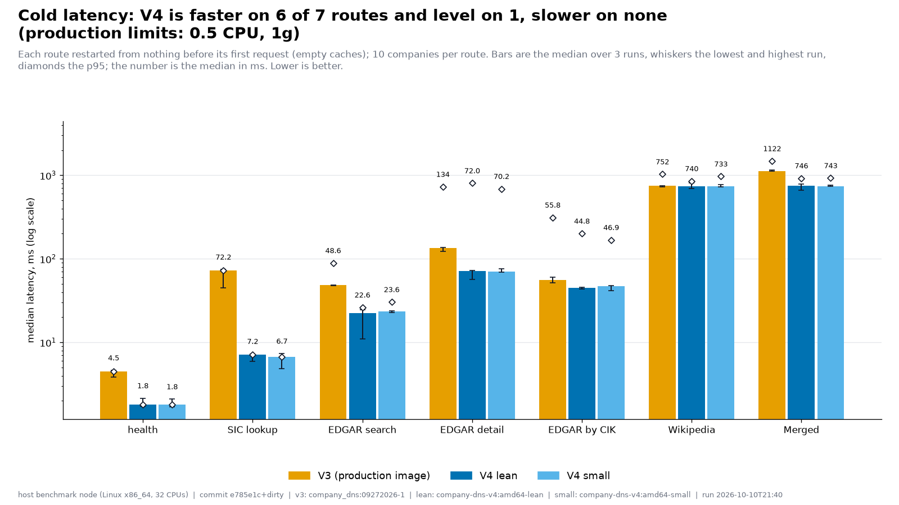

Each route restarted from nothing before its first request (empty caches); 10 companies per route. Bars are the median over 3 runs, whiskers the lowest and highest run, diamonds the p95; the number is the median in ms. Lower is better.

## With repeat traffic V4's caches answer Wikipedia in 3.6 ms against 740 ms cold; V3, which has no result cache, takes 760 ms every time

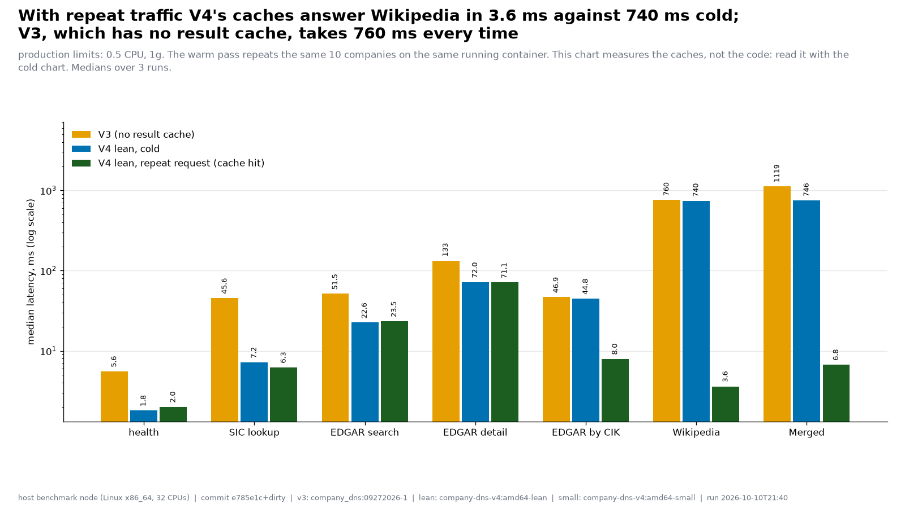

production limits: 0.5 CPU, 1g. The warm pass repeats the same 10 companies on the same running container. This chart measures the caches, not the code: read it with the cold chart. Medians over 3 runs.

## At 16 concurrent requests V4 finishes batches 4.8x faster on routes with no upstream call and 771x faster on routes that call Wikipedia and SEC, where V4 answers repeats from its cache (production limits: 0.5 CPU, 1g)

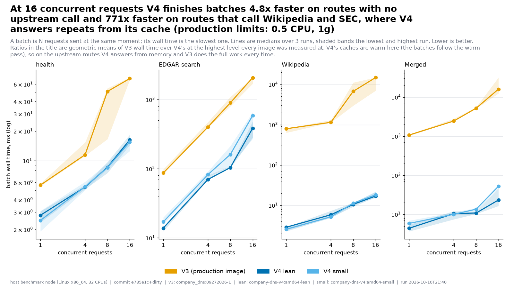

A batch is N requests sent at the same moment; its wall time is the slowest one. Lines are medians over 3 runs, shaded bands the lowest and highest run. Lower is better. Ratios in the title are geometric means of V3 wall time over V4's at the highest level every image was measured at. V4's caches are warm here (the batches follow the warm pass), so on the upstream routes V4 answers from memory and V3 does the full work every time.

## At 16 concurrent requests V4 serves 4.8x more requests per second on routes with no upstream call and 771x more on routes that call Wikipedia and SEC (V4 answers repeats from its cache), using 4.7x less average CPU (production limits: 0.5 CPU, 1g)

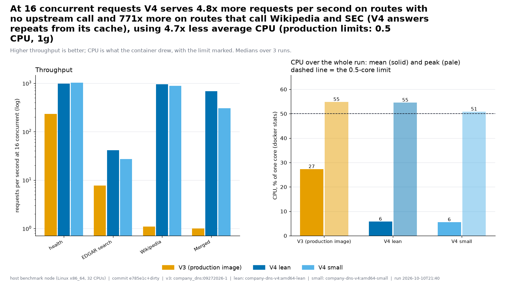

Higher throughput is better; CPU is what the container drew, with the limit marked. Medians over 3 runs.

## Cold latency: V4 is faster on 6 of 7 routes and level on 1, slower on none (headroom: 16 CPU, 64g)

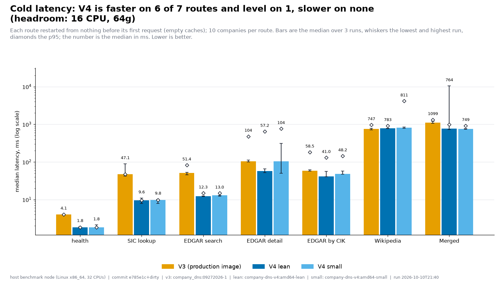

Each route restarted from nothing before its first request (empty caches); 10 companies per route. Bars are the median over 3 runs, whiskers the lowest and highest run, diamonds the p95; the number is the median in ms. Lower is better.

## With repeat traffic V4's caches answer Wikipedia in 3.4 ms against 783 ms cold; V3, which has no result cache, takes 766 ms every time

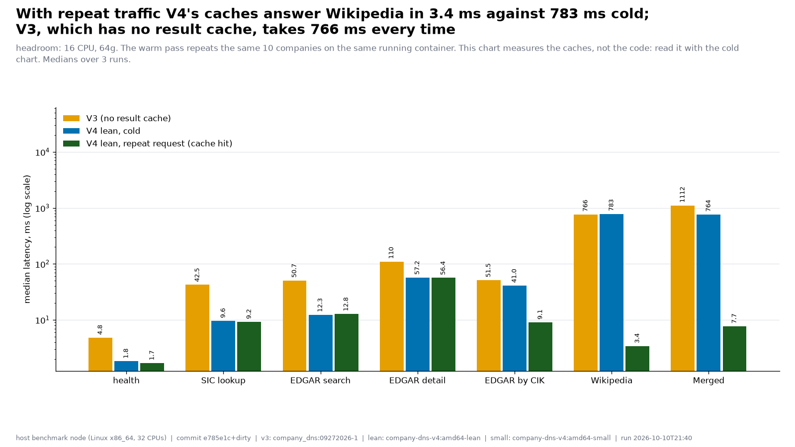

headroom: 16 CPU, 64g. The warm pass repeats the same 10 companies on the same running container. This chart measures the caches, not the code: read it with the cold chart. Medians over 3 runs.

## At 16 concurrent requests V4 finishes batches 3.5x faster on routes with no upstream call and 754x faster on routes that call Wikipedia and SEC, where V4 answers repeats from its cache (headroom: 16 CPU, 64g)

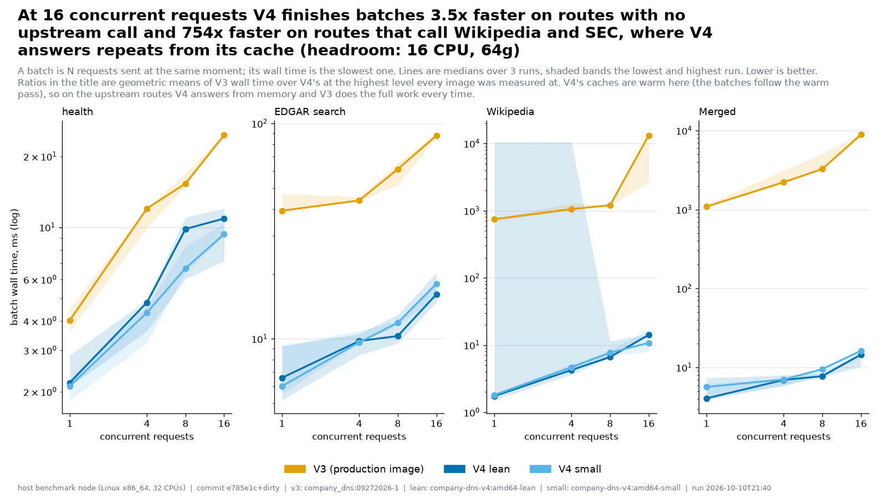

A batch is N requests sent at the same moment; its wall time is the slowest one. Lines are medians over 3 runs, shaded bands the lowest and highest run. Lower is better. Ratios in the title are geometric means of V3 wall time over V4's at the highest level every image was measured at. V4's caches are warm here (the batches follow the warm pass), so on the upstream routes V4 answers from memory and V3 does the full work every time.

## At 16 concurrent requests V4 serves 3.5x more requests per second on routes with no upstream call and 754x more on routes that call Wikipedia and SEC (V4 answers repeats from its cache), using 9.7x less average CPU (headroom: 16 CPU, 64g)

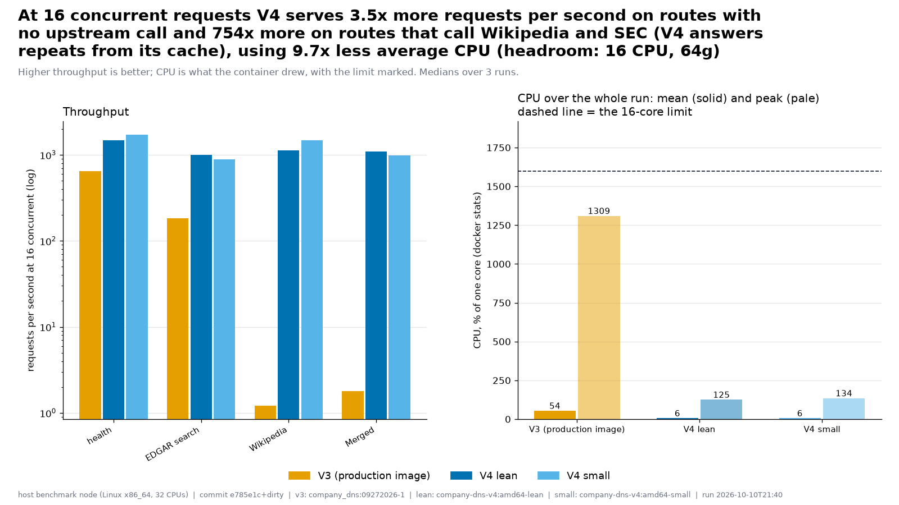

Higher throughput is better; CPU is what the container drew, with the limit marked. Medians over 3 runs.

## V4 lean: its image is 2.1x smaller, it starts 2.7x faster

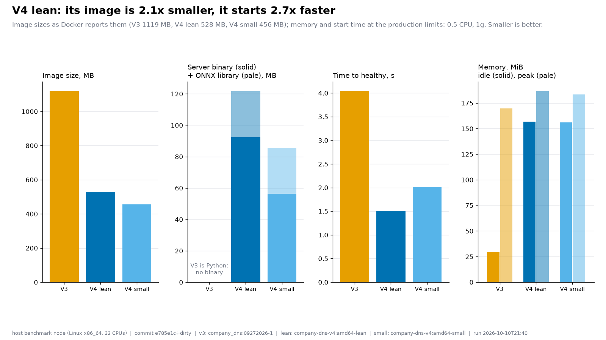

Image sizes as Docker reports them (V3 1119 MB, V4 lean 528 MB, V4 small 456 MB); memory and start time at the production limits: 0.5 CPU, 1g. Smaller is better.

## Failed, errored or incomplete answers: V3 1 incomplete; V4 lean 25 error status; V4 small none

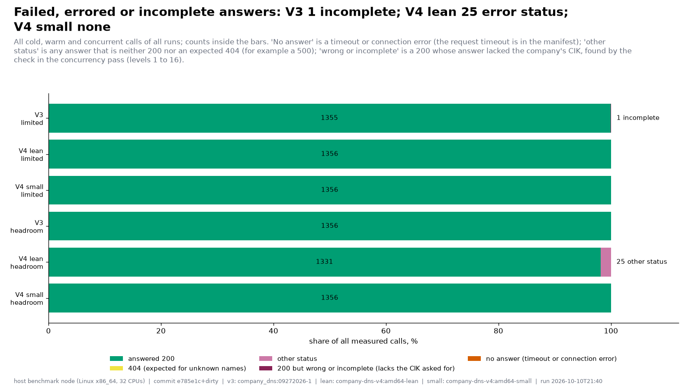

All cold, warm and concurrent calls of all runs; counts inside the bars. 'No answer' is a timeout or connection error (the request timeout is in the manifest); 'other status' is any answer that is neither 200 nor an expected 404 (for example a 500); 'wrong or incomplete' is a 200 whose answer lacked the company's CIK, found by the check in the concurrency pass (levels 1 to 16).

## Where V4's gains come from, and which of them we measured

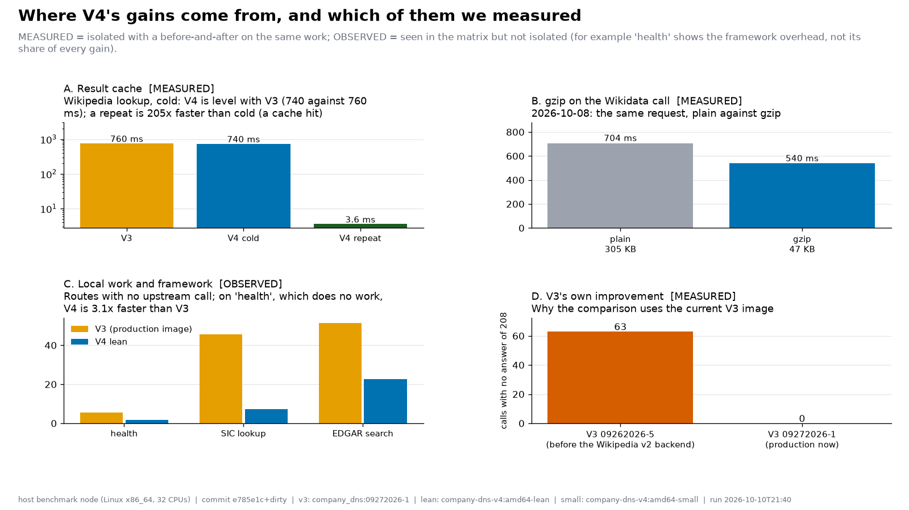

MEASURED = isolated with a before-and-after on the same work; OBSERVED = seen in the matrix but not isolated (for example 'health' shows the framework overhead, not its share of every gain).

## All 7 intentional differences from V3, each with its reason

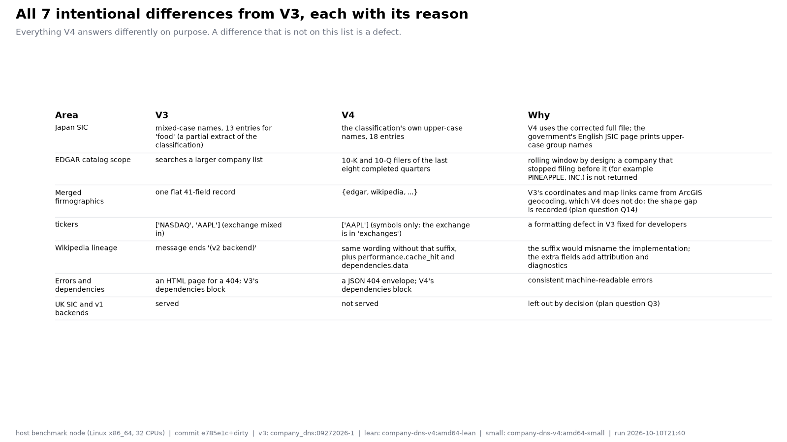

Everything V4 answers differently on purpose. A difference that is not on this list is a defect.

## Not drawn

- `f1-route-coverage`: needs specs/v3-openapi.json and specs/v4-openapi.json (run_matrix.py --extras)
- `f2-parity`: needs parity/<image>.json from parity_report.py --json
- `f4-tests`: needs suite/<image>.json from api_tests/run.py --report
- `f5-what-v4-adds`: needs specs/v3-openapi.json and specs/v4-openapi.json (run_matrix.py --extras)
